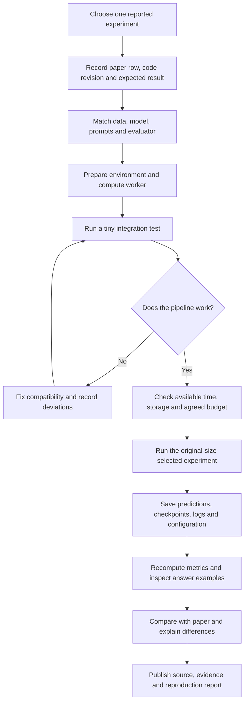
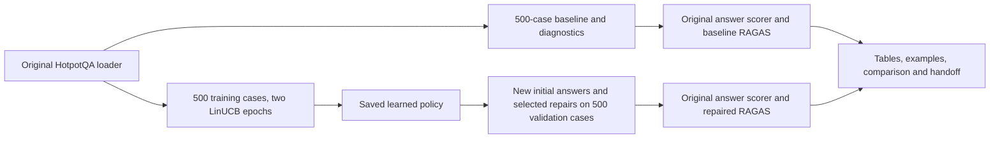

# A reusable pipeline for reproducing a paper

**Purpose:** run a selected published experiment, compare its results and explain
deviations. A new method or the group's full research hypothesis is not required.
This is a workflow and planning guide, not a claim that one command runs all papers.
Only D2R-RAG has been executed in this repository. The other paper cards below
are preliminary README-based plans, checked October 31, 2026; exact experiments,
commits, assets, licenses and resource requirements must be verified before running.

## Shared workflow for every paper

| Step | Same for every paper | What must be chosen separately |
|---|---|---|
| 1. Define scope | Name the exact claim/result being reproduced | Dataset, table row, backbone, method and training vs checkpoint evaluation |
| 2. Pin inputs | Record immutable source and asset versions | Model/checkpoint, corpus/index, split/filter and annotation version |
| 3. Set up | Separate environment and capture dependencies | Python/CUDA stack, APIs, serving processes, GPU count/VRAM |
| 4. Smoke test | A few cases to verify input-to-output execution | Minimal batch shape and whether training is needed |
| 5. Full execution | Use the selected published settings | Training schedule, retrieval settings and inference/generation settings |
| 6. Evaluate | Preserve predictions and run the original evaluator | Answer, classifier, span, trajectory or policy metrics |
| 7. Audit | Inspect examples and metric implementation | Normalization, matching rules, annotation quality and error categories |
| 8. Compare | Paper score vs reproduced score with deviations | Missing assets, stochastic effects, changed models/hardware |
| 9. Handoff | Source, commands, manifest, environment, logs, results | Large checkpoint/cache distribution and licensing limitations |

A small test proves integration only. Evaluating an author's released checkpoint
can reproduce an inference result, but does not reproduce training. Replacing a
model or dataset is an adaptation; label it clearly rather than silently claiming
the original setting. Report an incomplete run as incomplete.

## D2R-RAG: the pipeline we actually completed

Within each inference stage: evidence retrieval → generation → knowledge-graph/NLI
checks → failure category → optional policy-selected repair → final output. The
repair stage regenerates initial answers; it does not load the saved baseline
answers. The final diagnosis is post-repair. This matters for paired interpretation.

Completed settings and evidence are in `reproduction/PROTOCOL.md`, executed
`results/hotpotqa-full-linucb/*-plan.json`, and the full report. Practical differences:
API generator plus local diagnostic models; bandit training; persistent paid-call
ledger; cached graph/index construction; authors' answer-containment scorer;
RAGAS scoring. We fixed compatibility in wrappers and retained original source.

## How the other originally listed papers differ

These cards describe tasks to verify, not work already performed or new spending
authorization. They do not automatically include RAG-Critic or RePAIR from the
broader presentation; add a separate scope card if the team assigns those papers.

### RAG Error Classification

The [authors' repository](https://github.com/layer6ai-labs/rag-error-classification)
provides Dragonball/CLAPnq pipelines, Hydra configuration, OpenAI setup and a
released human-annotated error dataset. Its annotations distinguish pipeline
stages and error types. **Reproduction-specific work:** choose a reported analysis
or evaluation, preserve label definitions and query-ID joins, reproduce artifact
construction and judge settings, and compare the selected classification/error
analysis result. Do not substitute answer accuracy for taxonomy performance or
treat model-generated labels as human gold. Training is not automatically required;
check the chosen result. The README exposes scripts and saved artifact conventions.

### Doctor-RAG / DR-RAG

The [authors' repository](https://github.com/Fdioa/dr_rag_open) separates diagnosis
and targeted trajectory repair, with prefix reuse and optional diagnosis-model
distillation. **Reproduction-specific work:** preserve failed trajectory inputs,
backbone/retriever settings, culprit-step localization and shared comparison cases.
Distinguish evaluating an available diagnosis checkpoint from recreating teacher
annotation and student training. Record the valid prefix and repair output.
Its reported repair comparisons use failed trajectories, so their repair-rate
population differs from D2R-RAG's entire validation set. Verify checkpoints,
input traces and training assets before choosing the exact result to reproduce.

### RLSeek

The [authors' repository](https://github.com/WaldenRUC/RLSeek) uses a modified
`verl` training stack, span-F1 reward components and CAPO-related code, with a
training launcher and checkpoint recovery. **Reproduction-specific work:** inspect
`run.sh` for actual model/data/resource settings, verify the data and checkpoints,
match the PyTorch/vLLM/attention stack, and distinguish checkpoint evaluation from
reproducing RL training. Inspect the exact evidence/span output and evaluator for
the chosen paper result. Do not assume a D2R-style answer-generation pipeline or
that the GTX1080Ti used here supports this software stack. GPU requirements remain
to be measured from the actual configuration; no cost or runtime is promised.

## What each teammate should hand in

Use [PAPER_REPRODUCTION_TEMPLATE.md](PAPER_REPRODUCTION_TEMPLATE.md) for each paper.
A complete handoff contains an exact scope, runnable commands, input versions,
expected/observed metric table, compatibility changes, full outputs, representative
examples, limitations and the status of any unexecuted branches. Record whether
it is preparation, smoke-only, a complete scoped reproduction, or an adaptation.

Do not make scores across these four papers into a leaderboard: different tasks,
models, populations, datasets and evaluators make raw percentages incomparable.
For future TrustRAG comparisons, a shared model, evidence/action space and budget
would be a separate controlled experiment after reproduction.
